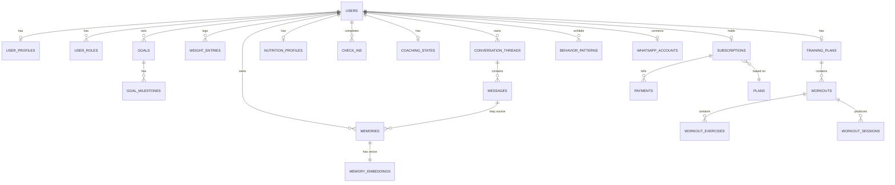

# LOSE10 — Database Architecture

PostgreSQL 16 + `pgvector` extension. Flyway-managed migrations. All tables use `uuid` primary keys (`gen_random_uuid()`) unless noted. All tables have `created_at timestamptz`; mutable tables also have `updated_at timestamptz`.

## 1. Core ERD (simplified — primary relationships)

Full domain detail below. Junction/event tables are listed but not diagrammed for readability.

## 2. Schema by Domain

### AUTH
| Table | Key columns | Notes |
|---|---|---|
| `users` | email (unique, citext), phone_e164 (unique, nullable), password_hash, status (`ACTIVE/SUSPENDED/DELETED`), email_verified_at, created_at | Source of identity. Never store plaintext password. |
| `user_roles` | user_id, role (`USER/ADMIN/SUPPORT/COACH`) | Many-to-many via composite PK. |
| `sessions` | user_id, session_token_hash, ip, user_agent, expires_at, revoked_at | Web session tracking. |
| `refresh_tokens` | user_id, token_hash, family_id, expires_at, revoked_at, replaced_by | Rotation: reuse of a revoked token revokes the whole family. |

### USER
| Table | Key columns | Notes |
|---|---|---|
| `user_profiles` | user_id (1:1), display_name, date_of_birth, sex, height_cm, country, timezone, locale | Timezone drives all scheduling. |
| `user_preferences` | user_id, units (`METRIC/IMPERIAL`), coach_style (`SUPPORTIVE/BALANCED/TOUGH_LOVE`) | |
| `user_settings` | user_id, notification_frequency, quiet_hours_start/end | |
| `user_consents` | user_id, consent_type, version, granted_at, source, revoked_at | Append-only; never hard-delete a consent record, revoke instead. |

### USER GOALS
| Table | Key columns | Notes |
|---|---|---|
| `goals` | user_id, goal_type (`LOSE_WEIGHT`, extensible enum), starting_weight_kg, target_weight_kg, target_date, status (`ACTIVE/ACHIEVED/ABANDONED/PAUSED`) | One active goal per user enforced at service layer. |
| `goal_milestones` | goal_id, percentage (5/25/50/75/90/100), reached_at, notified_at | |
| `goal_events` | goal_id, event_type, payload jsonb, created_at | Audit trail of goal edits (target changed, paused, etc.). |

### WEIGHT
| Table | Key columns | Notes |
|---|---|---|
| `weight_entries` | user_id, weight_kg numeric(5,2), recorded_at, source (`USER_REPORTED/DEVICE`) | Indexed on (user_id, recorded_at). |
| `body_measurements` | user_id, measurement_type, value, unit, recorded_at | Optional (waist, etc.). |

### PROGRESS
| Table | Key columns | Notes |
|---|---|---|
| `progress_snapshots` | user_id, period_start, period_end, rolling_avg_weight_kg, trend_kg_per_week | Computed nightly; drives dashboard + coach context. Trend uses 7-day rolling average, never single readings (see §25 of product spec). |
| `progress_metrics` | snapshot_id, metric_key, metric_value | Extensible key/value (adherence %, workout completion %, etc.). |

### TRAINING
| Table | Key columns | Notes |
|---|---|---|
| `training_plans` | user_id, goal_id, status, current_version_id | |
| `training_plan_versions` | plan_id, version_no, environment (`HOME/GYM/OUTDOOR`), reason_for_change, created_at | Full version history preserved. |
| `workouts` | plan_version_id, day_of_week, workout_type | |
| `workout_exercises` | workout_id, exercise_id, sets, reps, duration_sec, rest_sec, intensity, notes, order_index | |
| `exercise_library` | name, muscle_group, equipment, difficulty, video_url | Seed data. |
| `workout_sessions` | user_id, workout_id, completed_at, perceived_effort, notes | Actual completion log. |

### NUTRITION
| Table | Key columns | Notes |
|---|---|---|
| `nutrition_profiles` | user_id, dietary_restrictions jsonb, disliked_foods jsonb, target_calories, target_protein_g | |
| `nutrition_logs` | user_id, log_date | One per user per day. |
| `meals` | nutrition_log_id, meal_time, meal_type | |
| `meal_items` | meal_id, raw_text, estimated_calories, estimated_protein_g, source (`USER_TEXT/AI_ESTIMATE`) | v1 logging is conversational free text + AI estimate, not a food database lookup. |

### CHECK-INS
| Table | Key columns | Notes |
|---|---|---|
| `check_ins` | user_id, check_in_type (`MORNING/EVENING/WEEKLY`), scheduled_for, completed_at, responses jsonb | |
| `daily_check_ins` | user_id, date, mood, energy, adherence_self_report | |
| `weekly_reviews` | user_id, week_start, summary_text, generated_by (`AI/ADMIN`) | |

### COACHING
| Table | Key columns | Notes |
|---|---|---|
| `coaching_states` | user_id (1:1), mode (`AI_ACTIVE/HUMAN_ACTIVE/PAUSED`), style, paused_reason, updated_by | Drives whether the AI is allowed to auto-respond. |
| `coaching_events` | user_id, event_type, payload jsonb, actor (`AI/USER/ADMIN/SYSTEM`), created_at | |
| `coach_preferences` | user_id, key, value | Free-form overrides (e.g. "no morning messages before 8am"). |

### CONVERSATIONS
| Table | Key columns | Notes |
|---|---|---|
| `conversation_threads` | user_id, channel (`WHATSAPP`), status | Currently one open thread per user per channel. |
| `messages` | thread_id, direction (`INBOUND/OUTBOUND`), sender (`USER/AI/ADMIN/SYSTEM`), content, ai_metadata jsonb (tokens, model, tool calls), whatsapp_message_id, created_at | Indexed on (thread_id, created_at). |
| `conversation_summaries` | thread_id, period_start, period_end, summary_text, created_at | Medium-term memory layer. |

### MEMORY
| Table | Key columns | Notes |
|---|---|---|
| `memories` | user_id, category, key, content, importance (`LOW/MEDIUM/HIGH/CRITICAL`), confidence numeric(3,2), source_message_id, expires_at, last_used_at, metadata jsonb, created_at, updated_at | See [MEMORY.md](MEMORY.md) for extraction/retrieval rules. Unique-ish on (user_id, category, key) — updates supersede, don't duplicate. |
| `memory_events` | memory_id, event_type (`CREATED/UPDATED/CONTRADICTED/EXPIRED/DELETED`), previous_content, created_at | Full history for auditability and "why did the coach say that". |
| `memory_embeddings` | memory_id (1:1, FK), embedding vector(1536), model, dimension, embedding_version, created_at | See §5 below for indexing. |

### BEHAVIOR
| Table | Key columns | Notes |
|---|---|---|
| `behavior_patterns` | user_id, pattern_key (e.g. `friday_night_overeating`), description, confidence numeric(3,2), occurrence_count, first_observed_at, last_observed_at, status (`ACTIVE/RESOLVED`) | |
| `behavior_events` | user_id, pattern_id nullable, event_type, payload jsonb, created_at | Raw signal log the behavior engine aggregates from. |

### NOTIFICATIONS
| Table | Key columns | Notes |
|---|---|---|
| `scheduled_messages` | user_id, message_type (enum, see WHATSAPP.md §4), scheduled_for (timestamptz, computed from user timezone), status (`PENDING/SENT/SKIPPED/FAILED`), payload jsonb | Idempotency key = (user_id, message_type, scheduled_for::date). |
| `notification_preferences` | user_id, morning_checkin_time, evening_checkin_time, workout_reminder_enabled, quiet_hours | |
| `notification_events` | scheduled_message_id, event_type, occurred_at | Delivery lifecycle. |

### WHATSAPP
| Table | Key columns | Notes |
|---|---|---|
| `whatsapp_accounts` | user_id, phone_e164, wa_id, status (`PENDING/CONNECTED/OPTED_OUT`), opted_in_at, opted_out_at | |
| `whatsapp_messages` | direction, wa_message_id (unique), status (`SENT/DELIVERED/READ/FAILED`), message_id FK → messages, raw_payload jsonb | |
| `whatsapp_webhook_events` | event_id (unique, idempotency key), payload jsonb, processed_at, processing_status | Every webhook delivery recorded before processing — dedupes Meta's at-least-once delivery. |

### SUBSCRIPTIONS
| Table | Key columns | Notes |
|---|---|---|
| `plans` | name, stripe_price_id, amount, currency, interval (`MONTH/YEAR`), trial_days, active | |
| `subscriptions` | user_id, stripe_subscription_id (unique), plan_id, status, trial_end, current_period_end, cancel_at_period_end | Status mirrors Stripe; Stripe webhook is authoritative. |
| `subscription_events` | subscription_id, stripe_event_id (unique, idempotency), event_type, payload jsonb, created_at | |
| `coupons` | code (unique), stripe_coupon_id, discount_type, discount_value, valid_from, valid_until, max_redemptions | |

### PAYMENTS
| Table | Key columns | Notes |
|---|---|---|
| `payments` | subscription_id, stripe_payment_intent_id (unique), amount, currency, status, created_at | |
| `refunds` | payment_id, stripe_refund_id (unique), amount, reason, created_at | |

### ADMIN
| Table | Key columns | Notes |
|---|---|---|
| `admin_notes` | user_id, admin_id, note, created_at | |
| `admin_actions` | admin_id, action_type, target_type, target_id, metadata jsonb, created_at | |
| `human_interventions` | user_id, admin_id, reason, started_at, ended_at | Correlates with `coaching_states.mode = HUMAN_ACTIVE`. |

### SAFETY
| Table | Key columns | Notes |
|---|---|---|
| `safety_events` | user_id, message_id, category (`EATING_DISORDER/SELF_HARM/MEDICAL/INJURY/OTHER`), severity (`LOW/MEDIUM/HIGH/CRITICAL`), detected_by (`AI/RULE/ADMIN`), created_at | |
| `safety_flags` | safety_event_id, flag_type, resolved boolean | |
| `safety_reviews` | safety_event_id, reviewer_id (admin), resolution, resolved_at | CRITICAL events page a human; see SECURITY.md. |

### ANALYTICS
| Table | Key columns | Notes |
|---|---|---|
| `analytics_events` | user_id nullable, event_type, metadata jsonb, occurred_at | Append-only event stream (see BUSINESS_LOGIC.md for full event catalog). |
| `ai_requests` | user_id, provider, model, request_type, input_tokens, output_tokens, estimated_cost_usd numeric(10,6), latency_ms, created_at | One row per Claude call. Primary input to AI cost dashboard. |
| `ai_usage` / `ai_costs` | materialized views or nightly rollup tables over `ai_requests`, grouped by day/user/model | Rollups, not raw storage — avoid recomputing full scans for dashboards. |

### AUDIT
| Table | Key columns | Notes |
|---|---|---|
| `audit_logs` | actor_id nullable, actor_type (`USER/ADMIN/SYSTEM`), action, target_type, target_id, metadata jsonb, created_at | Security-relevant actions only (see SECURITY.md §7 for the event list). No sensitive payloads logged in cleartext. |

## 3. Indexing Strategy

- Every FK column: btree index.
- Every `(user_id, created_at)` / `(user_id, recorded_at)` pattern used for history queries: composite btree index, `created_at DESC`.
- `scheduled_messages`: index on `(status, scheduled_for)` for the scheduler's due-message poll.
- `whatsapp_webhook_events.event_id`: unique index (idempotency).
- `subscription_events.stripe_event_id`, `payments.stripe_payment_intent_id`: unique indexes (idempotency).
- `memories`: composite index on `(user_id, category)`; partial index on `(user_id) WHERE expires_at IS NOT NULL AND expires_at > now()` to speed active-memory retrieval.
- `messages`: index on `(thread_id, created_at DESC)` for recent-conversation loads.

## 4. pgvector Index Strategy

- Column: `memory_embeddings.embedding vector(1536)` (dimension matches the chosen embedding model; stored explicitly in the row so a model change is a data migration, not a schema break).
- **Index choice: HNSW**, `vector_cosine_ops`. Rationale: at launch scale (thousands, growing to low millions of memory rows — note this is *memories per user*, bounded and pruned, not raw messages, so total row count stays modest for years), HNSW gives better query latency and recall than IVFFlat without needing a periodic `REINDEX`/retrain step that IVFFlat's cluster-list approach requires as data grows. IVFFlat is reconsidered only if write throughput on the embeddings table becomes a bottleneck (HNSW build cost is higher on insert).
- Query pattern: filter by `user_id` first (tenant boundary, uses the btree index on the parent `memories` row), then order by `embedding <=> query_embedding` within that filtered set, `LIMIT K`. Because each user's memory set is small, the vector index mainly protects against a single noisy-neighbor user's history size, not global scale.
- `ef_search` tuned at query time (start at 40, revisit under load testing).

## 5. Migration Discipline
- Flyway, one directory per module is *not* used — single linear `V{n}__description.sql` history in `backend/src/main/resources/db/migration`, since Flyway requires a single ordered history. Table creation order follows the domain list above (auth → user → goal → ... → audit) to satisfy FK dependencies.
- No manual production schema edits, ever. No down-migrations maintained (roll forward only), per standard Flyway practice.
